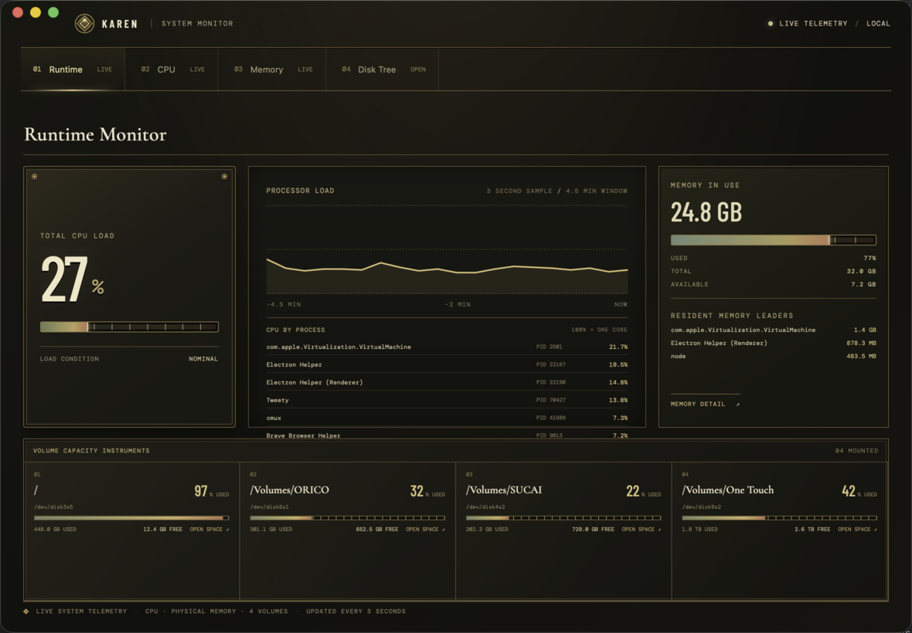

#  Karen



Karen is a cross-platform system monitor and disk-space explorer. Runtime
shows live CPU, physical memory and mounted-volume usage. CPU and Memory tabs
show per-process usage. Space maps allocated file space and provides a
review-before-removal workflow.

## Desktop

Requires Rust 1.97+, Node.js 22+, and pnpm 10+.

```sh
pnpm install
pnpm dev
```

Runtime opens first and does not scan files. Open **Space** to choose a
volume and start its first scan. Cached tree navigation does not rescan.
Marking a path is non-destructive. Review marks and confirm before moving
items to Trash or deleting permanently.

Build release bundles with:

```sh
pnpm tauri
```

Tauri bundles the Vue interface and the matching-platform `karen` CLI sidecar.
Rust outputs, including desktop bundles and sidecar staging, live under the
root `target/` directory.

## CLI

Build and run standalone CLI:

```sh
cargo build --release -p karen-cli
target/release/karen --help
target/release/karen /path/to/scan
```

`karen --stream-json` starts the versioned JSON-lines interface used by the
desktop app. It accepts requests on stdin, emits events on stdout and keeps
diagnostics on stderr. CLI owns scan state, telemetry, tree navigation, marks,
review and guarded removal. Tauri only manages the window and scoped sidecar.

## Checks

```sh
pnpm lint
pnpm test
pnpm --dir apps/desktop build
```

Linux desktop builds need Tauri's WebKitGTK 4.1 and GTK development libraries.
See [Tauri prerequisites](https://v2.tauri.app/start/prerequisites/).

## Project structure

- `apps/cli/` — standalone CLI and JSON-lines protocol
- `apps/desktop/` — Tauri 2, Vue 3 and custom window chrome
- `crates/monitor-core/` — CLI-owned resource and disk state
- `crates/monitor-cpu/` — CPU sampling
- `crates/monitor-memory/` — memory sampling
- `crates/monitor-disk/` — scan, treemap, space and removal safety
- `.agents/skills/karen-design/` — interface design rules and review checklist
- `.impeccable/` — project visual reference

RFCs live in `.spec/`. Use the Specify skill CLI for status changes and
archiving; run `sync-check` after updates.
